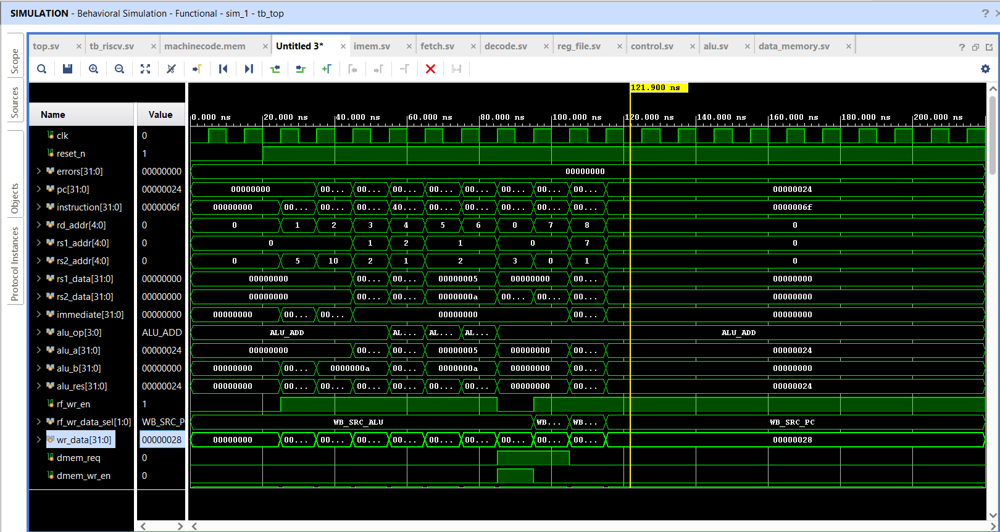
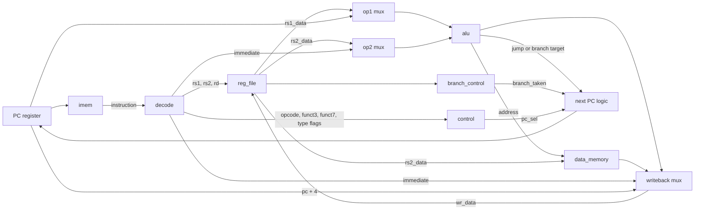

# RV32I Single-Cycle RISC-V Processor (SystemVerilog)

A single-cycle RISC-V core written in SystemVerilog. It executes one instruction per clock cycle and implements the RV32I base integer instruction set, except `FENCE`, `ECALL` and `EBREAK`. It comes with self-checking testbenches and was simulated in Vivado 2025.2 (xsim) and Icarus Verilog 12.

> **Status:** verified in simulation only. It has not been synthesized, timed, or run on an FPGA.



---

## Contents

1. [Features](#features)
2. [Architecture](#architecture)
3. [Files](#files)
4. [Quick start: Vivado](#quick-start-vivado)
5. [Quick start: command line (Icarus / Verilator)](#quick-start-command-line-icarus--verilator)
6. [Test programs and expected results](#test-programs-and-expected-results)
7. [Viewing the waveform](#viewing-the-waveform)
8. [Writing your own program](#writing-your-own-program)
9. [Verification status](#verification-status)
10. [Limitations](#limitations)
11. [Troubleshooting](#troubleshooting)
12. [Changelog: fixes from the first version](#changelog-fixes-from-the-first-version)
13. [Next steps](#next-steps)

---

## Features

| Group | Instructions |
|---|---|
| R-type ALU | `ADD SUB SLL SLT SLTU XOR SRL SRA OR AND` |
| I-type ALU | `ADDI SLTI SLTIU XORI ORI ANDI SLLI SRLI SRAI` |
| Loads | `LB LH LW LBU LHU` |
| Stores | `SB SH SW` |
| Branches | `BEQ BNE BLT BGE BLTU BGEU` |
| Jumps | `JAL JALR` |
| Upper immediate | `LUI AUIPC` |

That is 37 instructions in total. Other design properties:

- **Harvard memories:** separate instruction memory and data memory.
- **Little-endian, byte-addressed data memory** with byte, half-word and word access. Loads are sign- or zero-extended as RISC-V requires.
- **x0 is hard-wired to zero:** writes to it are ignored and it always reads 0.
- **Active-low asynchronous reset** (`reset_n`). The PC starts at `RESET_PC` (default `0x0`).
- **Shared definitions:** all opcodes, ALU operations and control encodings live in one package (`riscv_pkg`), declared as typed enums.

---

## Architecture



### Modules

| Module | File | Role |
|---|---|---|
| `riscv_pkg` | `riscv_pkg.sv` | Opcode, ALU-operation, memory-size, writeback-source and decode-table enums, plus the `control_t` struct |
| `top` | `top.sv` | Wires the datapath. Holds the PC register, the next-PC logic, the operand muxes and the writeback mux |
| `fetch` | `fetch.sv` | Drives the instruction-memory address from the PC. Raises `imem_req` one cycle after reset is released |
| `imem` | `imem.sv` | Read-only instruction memory, 64 words × 32 bits. Loaded from `machinecode.mem` with `$readmemh`. Empty words are filled with NOP (`00000013`) |
| `decode` | `decode.sv` | Splits the instruction into fields, sets the instruction-type flags, and builds the immediate for each format |
| `control` | `control.sv` | Produces every datapath control signal from the opcode, funct3 and funct7 |
| `branch_control` | `control.sv` | Compares rs1 and rs2 for the six branch conditions and outputs `branch_taken` |
| `reg_file` | `reg_file.sv` | 32 × 32-bit registers. Two combinational read ports, one write port on the rising clock edge |
| `alu` | `alu.sv` | The 10 operations: ADD, SUB, SLL, SRL, SRA, OR, AND, XOR, SLT (signed), SLTU (unsigned) |
| `data_memory` | `data_memory.sv` | 64-byte data memory. Combinational read, write on the rising clock edge, little-endian |

### Next-PC logic

```systemverilog
next_pc = (branch_taken | pc_sel) ? {alu_res[31:1], 1'b0} : pc + 4;
```

The ALU always computes the jump or branch target:

- JAL and branches: `PC + imm`
- JALR: `rs1 + imm`

`pc_sel` is set for JAL and JALR. `branch_taken` is set when a branch condition is true.

### Control signals by instruction class

| Class | ALU input A | ALU input B | `alu_op` | `rf_wr_en` | Writeback source | `dmem_req` / `dmem_wr_en` | `pc_sel` |
|---|---|---|---|---|---|---|---|
| R-type | rs1 | rs2 | from `{funct7[5], funct3}` | 1 | ALU | 0 / 0 | 0 |
| I-type ALU | rs1 | imm | from `{opcode[4], funct3}` | 1 | ALU | 0 / 0 | 0 |
| Load | rs1 | imm | ADD | 1 | MEM | 1 / 0 | 0 |
| Store | rs1 | imm | ADD | **0** | – | 1 / 1 | 0 |
| Branch | PC | imm | ADD | 0 | – | 0 / 0 | 0 (`branch_taken` decides) |
| JAL | PC | imm | ADD | 1 | PC + 4 | 0 / 0 | 1 |
| JALR | rs1 | imm | ADD | 1 | PC + 4 | 0 / 0 | 1 |
| LUI | – | – | ADD | 1 | IMM | 0 / 0 | 0 |
| AUIPC | PC | imm | ADD | 1 | ALU | 0 / 0 | 0 |

### Timing

- **One instruction per cycle.** During the cycle, all combinational logic settles. At the rising edge, the register file, the data memory and the PC save their new values.
- **Start-up after reset.** `reset_n` is released at 20 ns in the testbench.
  - At the first rising edge (25 ns), `imem_req` goes high, so the first instruction appears. The PC does not advance on this edge.
  - The first instruction's result is written at 35 ns.

### Memory map

| Memory | Size | Addressing |
|---|---|---|
| Instruction | 64 words (256 bytes) | Word index = `PC[7:2]`. Higher PC bits are ignored, so addresses wrap every 256 bytes |
| Data | 64 bytes | Byte index = `addr[5:0]`. Higher address bits are ignored, so addresses wrap every 64 bytes |

To enlarge either memory, change its `ADDR_WIDTH` parameter.

---

## Files

| File | Purpose |
|---|---|
| `riscv_pkg.sv` | Shared package. **Must be first in compile order** |
| `top.sv`, `fetch.sv`, `imem.sv`, `decode.sv`, `control.sv`, `reg_file.sv`, `alu.sv`, `data_memory.sv` | RTL (the hardware design) |
| `tb_riscv.sv` | Basic self-checking testbench (module `tb_top`) |
| `machinecode.mem` | Basic test program: 10 instructions, loaded by `imem` |
| `program.s` | Assembly source of `machinecode.mem` |
| `tb_full.sv` | Extended self-checking testbench (module `tb_full`) |
| `machinecode_full.mem` | Extended test program, 48 instructions |
| `program_full.s` | Assembly source of `machinecode_full.mem` |
| `add_waves.tcl` | Vivado script that adds all key signals to the waveform and runs the simulation |
| `bin2mem.py` | Converts an assembled binary into a `.mem` file |
| `waveform_annotated.png` | Annotated waveform of the basic test |

---

## Quick start: Vivado

1. **Create an RTL project** with no board or part-specific settings. Keep the path short, with no spaces, and outside OneDrive, e.g. `C:\vivado\riscv_sc\`.
2. **Design Sources:** add `riscv_pkg.sv`, `top.sv`, `fetch.sv`, `imem.sv`, `decode.sv`, `control.sv`, `reg_file.sv`, `alu.sv` and `data_memory.sv`.
3. **Simulation Sources:** add `tb_riscv.sv` **and** `machinecode.mem`. Vivado only copies the `.mem` file into the simulation folder if it is a simulation source.
4. **Check the file types.** Right-click each `.sv` file → *Source File Properties* → **Type = SystemVerilog**.
5. **Check the compile order.** `riscv_pkg.sv` must be at **position 1**.
6. **Set the tops:**
   - `top` in Design Sources.
   - `tb_top` in Simulation Sources → sim_1 (right-click → *Set as Top*).
7. **Run** *Run Simulation → Run Behavioral Simulation*.
8. **Read the Tcl Console.** It should end with `*** TEST PASSED ***`.

> **Note:** the package is never shown under `top` in the Hierarchy view. It is not instantiated, so seeing it only in Compile Order is normal.

---

## Quick start: command line (Icarus / Verilator)

Run these from the folder that contains the files. `imem` opens `machinecode.mem` from the current directory.

```bash
# Simulate the basic test
iverilog -g2012 -o sim.vvp riscv_pkg.sv alu.sv control.sv data_memory.sv decode.sv \
    fetch.sv imem.sv reg_file.sv top.sv tb_riscv.sv
vvp -n sim.vvp

# Lint the RTL
verilator --lint-only -Wall -Wno-DECLFILENAME -Wno-UNUSEDSIGNAL --top-module top \
    riscv_pkg.sv alu.sv control.sv data_memory.sv decode.sv fetch.sv imem.sv reg_file.sv top.sv
```

Icarus 12 prints `sorry: constant selects in always_* processes are not currently supported`. This is a limitation of Icarus, not a design error, and the simulation result is unaffected.

---

## Test programs and expected results

### Basic test: `tb_riscv.sv` + `machinecode.mem`

| Address | Instruction | Hex | Result |
|---|---|---|---|
| 0x00 | `addi x1, x0, 5` | `00500093` | x1 = 5 |
| 0x04 | `addi x2, x0, 10` | `00A00113` | x2 = 10 |
| 0x08 | `add x3, x1, x2` | `002081B3` | x3 = 15 |
| 0x0C | `sub x4, x2, x1` | `40110233` | x4 = 5 |
| 0x10 | `and x5, x1, x2` | `0020F2B3` | x5 = 0 |
| 0x14 | `or x6, x1, x2` | `0020E333` | x6 = 15 |
| 0x18 | `sw x3, 0(x0)` | `00302023` | mem[0..3] = `0F 00 00 00` |
| 0x1C | `lw x7, 0(x0)` | `00002383` | x7 = 15 |
| 0x20 | `addi x8, x7, 1` | `00138413` | x8 = 16 |
| 0x24 | `jal x0, 0` | `0000006F` | halt (jumps to itself) |

At 220 ns the testbench checks x0–x8, data-memory word 0 and the PC (`0x24`), then prints `ok` or `FAIL` for each. Expected Tcl Console output:

```
Time = 25 ns | PC = 00000000 | Instruction = 00500093 | ALU_Res = 00000005 | WriteData = 00000005
Time = 35 ns | PC = 00000004 | Instruction = 00a00113 | ALU_Res = 0000000a | WriteData = 0000000a
...
Time = 115 ns | PC = 00000024 | Instruction = 0000006f | ALU_Res = 00000024 | WriteData = 00000028
------------- register / memory check -------------
ok  : x0 = 00000000
...
ok  : PC halted at 00000024
*** TEST PASSED ***
```

The `x0 = 0` check is a real test. `jal x0,0` tries to write `0x28` into x0 every cycle, so this check fails if the x0 write guard is missing.

### Extended test: `tb_full.sv` + `machinecode_full.mem`

The extended test covers what the basic test cannot reach:

- signed and unsigned compares (`SLT/SLTU/SLTI/SLTIU`)
- arithmetic and logical shifts on negative values
- `LUI` and `AUIPC`
- `SB/SH/SW` at non-zero offsets
- `LB/LBU/LH/LHU` sign handling
- all six branches
- `JAL` and `JALR`

It also checks every cycle that `JALR` never raises a data-memory request.

How to run it:

1. Back up `machinecode.mem`, then replace its contents with those of `machinecode_full.mem`. `imem` always loads the file named `machinecode.mem`.
2. Add `tb_full.sv` to Simulation Sources and **Set as Top**.
3. Run the simulation. Expected output, with `$finish` at 820 ns:
   ```
   *** FULL RV32I TEST PASSED (all 32 regs + PC) ***
   ```
4. Restore `machinecode.mem` and set `tb_top` as top again.

---

## Viewing the waveform

By default Vivado's wave window shows only the testbench's own signals (`clk`, `reset_n`, `errors`). To see the CPU signals:

- **Script:** *Tools → Run Tcl Script…* → `add_waves.tcl`. It adds the PC, instruction, register addresses and data, ALU, writeback, memory signals and the register-file and data-memory arrays, then restarts and runs.
- **By hand:** Scope → `tb_top` → `u_top`, select signals in Objects → *Add to Wave Window*, then type `restart` and `run all` in the Tcl Console. Signals added after a run have no history until you re-run.

**How to read it.** In each 10 ns cycle the signals settle; at the next rising edge, `regs[rd_addr]` takes `wr_data` if `rf_wr_en` = 1. Always place the cursor in the middle of a cycle, not on an edge. See `waveform_annotated.png` for four worked examples (ADD, SW, LW, JAL).

---

## Writing your own program

`machinecode.mem` format:

- One 32-bit instruction per line, in hex.
- The first line is address `0x00`.
- At most 64 lines.
- End the program with `0000006F` (`jal x0, 0`). Otherwise the PC runs on into the NOP-filled memory and wraps around.

**With the GNU RISC-V toolchain:**

```bash
riscv64-unknown-elf-as -march=rv32i -mabi=ilp32 -o prog.o prog.s
riscv64-unknown-elf-objcopy -O binary prog.o prog.bin
python3 bin2mem.py prog.bin machinecode.mem
```

Put `.option norvc` at the top of the `.s` file. Without it, the assembler may emit 16-bit compressed instructions, which this core does not support.

**With RARS:**

1. Before assembling, set *Settings → Memory Configuration → Compact, Text at Address 0* so that `AUIPC` and absolute addresses match this core.
2. Assemble, then *File → Dump Memory* → `.text` segment, *Hexadecimal Text* format.

---

## Verification status

| Check | Result |
|---|---|
| Basic test, Vivado 2025.2 xsim | Pass |
| Basic test, Icarus Verilog 12 | Pass; output identical to xsim |
| Extended test, Icarus Verilog 12 | Pass (all 32 registers + PC) |
| Verilator 5.020 lint (`-Wall`) | Clean |
| Bug injection | Each injected bug makes a test fail: SUB doing ADD, x0 write guard removed, `rf_wr_en` ignored, SRA without sign extension |

Coverage across both tests:

- **Every instruction runs at least once.** All 37 implemented instructions execute.
- **Gaps:**
  - Each branch is tested in one direction only. BEQ, BLT, BGE and BGEU are tested taken; BNE and BLTU are tested not taken.
  - There are no random or directed corner-case tests, e.g. shift by 31 or overflow on ADD.
  - There is no comparison against a reference model such as Spike, and the riscv-tests compliance suite has not been run.

---

## Limitations

- **No `FENCE`, `ECALL`, `EBREAK`, CSRs or exceptions.** Unknown opcodes execute as NOPs instead of trapping.
- **Misaligned loads and stores are not detected.** They access consecutive bytes rather than trapping.
- **Tiny memories that wrap.** There are 256 bytes of instruction memory and 64 bytes of data memory, and addresses wrap around instead of faulting.
- **Memories won't map to block RAM.** Reads are combinational, and a word store writes four separate byte addresses in one cycle. Vivado will therefore build both memories from LUTs and flip-flops instead of block RAM.
- **Long critical path.** Because the design is single-cycle, one clock period must cover the whole path from instruction memory through decode, register file, ALU, data memory and writeback. Timing has not been analysed.
- **Testbenches read internal signals.** They use hierarchical references such as `u_top.u_register_file.regs`, so renaming an instance breaks them.

---

## Troubleshooting

| Symptom | Cause / fix |
|---|---|
| `riscv_pkg` "not showing" under `top` | Normal: packages are not instantiated. Check that it is first in Compile Order and its type is SystemVerilog |
| `[filemgmt 56-12] ... already exists in the project, skipping` | Re-adding a file with *Add Sources* keeps the old copy. Open the file in Vivado and paste the new code instead |
| `[USF-XSim-62] 'compile' step failed` | The real error is in `<project>.sim/sim_1/behav/xsim/xvlog.log`, or in Tcl Console lines starting `ERROR: [VRFC` |
| Simulation top shows as `top` | Set `tb_riscv.sv` (module `tb_top`) as top in sim_1. `top` has no clock or reset source |
| Repeated `[filemgmt 56-199]` messages | The project is in a OneDrive-synced folder or a path with spaces. Move it |
| `instruction` = `00000013` everywhere / `$readmemh` cannot open file | `machinecode.mem` is not a simulation source, or not in the folder the simulator runs from |
| `$readmemh ... Not enough words` warning | Harmless: the program is shorter than the 64-word memory |
| Waveform shows only `clk`, `reset_n`, `errors` | See [Viewing the waveform](#viewing-the-waveform) |
| Can't type in Tcl Console | Use the single-line box at the bottom of the **Tcl Console** tab, not the Messages or Log tab; or use *Tools → Run Tcl Script* |

---

## Changelog: fixes from the first version

**Compile and elaborate errors:**

| Area | Problem | Fix |
|---|---|---|
| `data_memory` | `DATA WIDTH` had a space in it; no package import; wrong port names (`dmem_w_en`, `dmem_data_size`); output declared as a wire but driven from `always_comb` | Fixed the name, imported `riscv_pkg`, renamed the ports, made the output `logic` |
| `alu`, `control` | Used `ADD`, `SUB`… but the package defines `ALU_ADD`, `ALU_SUB`… | Use the `ALU_` names |
| `control` | `rf_wr_en` port missing; `dmem_wr` vs `dmem_wr_en` mismatch | Ports now match `top` |
| `fetch`, `reg_file` | Port `rst_n` vs `reset_n` connected in `top` | Unified as `reset_n` |
| `branch_control` | `assign` inside `always_comb` | Moved outside the block |
| `riscv_pkg` | `control_t.alu_op` was `logic [3:0]` driving an enum port | Changed to `alu_opcode_t`; ports now typed as `mem_size_t` / `wb_src_t` |

**Functional bugs:**

| Area | Problem | Fix |
|---|---|---|
| `imem` | 8-bit entries truncated each 32-bit instruction in the `.mem` file to its low byte; byte order was big-endian | Changed to a 32-bit word ROM indexed by `PC[7:2]` |
| `alu`, `branch_control` | `logic [31:0] signed_a = alu_a;` is a one-time initializer and unsigned, so SLT, BLT and BGE were wrong | Use `$signed()` inline |
| `alu` | SRA did a logical shift | `$signed(alu_a) >>> shamt` |
| `reg_file` | Ignored `rf_wr_en`, so stores and branches overwrote registers; x0 was writable | Write only when `rf_wr_en && rd != 0`; x0 always reads 0 |
| `control` | JALR also matched the `I_LB` decode entry, causing a spurious data-memory read | JALR handled before the decode table |
| `data_memory` | Indexed with the full 32-bit address | Uses the low `ADDR_WIDTH` bits |
| `machinecode.mem` | No halt; the PC ran into uninitialised memory | Added `jal x0, 0` |

---

## Next steps

- **Directed corner cases:** take every branch in both directions; shift by 0 and by 31; signed overflow; LB/LH on every byte offset.
- **Compliance:** run the official [riscv-tests](https://github.com/riscv-software-src/riscv-tests) `rv32ui` suite and compare register traces against Spike.
- **Synthesis:** synthesize and time the core in Vivado. Mapping the memories to block RAM needs registered reads and a 32-bit-wide data memory with byte-write enables.
- **5-stage pipeline:** IF/ID/EX/MEM/WB, with forwarding and hazard detection.
- **Exceptions:** add `ECALL`/`EBREAK`, CSRs and an illegal-instruction trap.